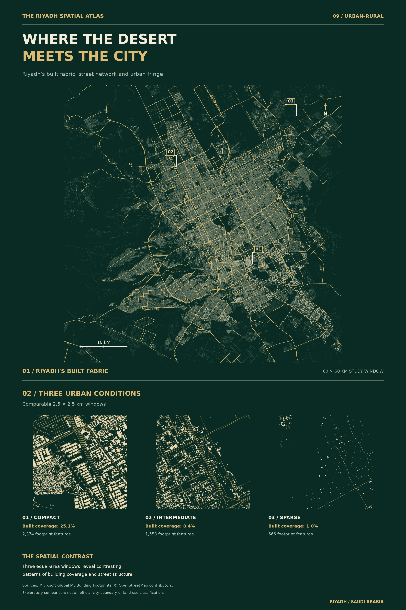

# WHERE THE DESERT MEETS THE CITY

**THE RIYADH SPATIAL ATLAS**

*30 Day Map Challenge 2026 | Day 09 — Urban–Rural*

---

## 01 | PROJECT OVERVIEW

Riyadh's built environment exhibits substantial spatial variation, from compact urban districts to sparsely developed areas near the desert fringe.

**Research Question**

How does building footprint coverage differ across selected urban conditions in Riyadh?

---

## 02 | THE FINAL ATLAS

[View the high-resolution atlas (PDF)](maps/day09_urban_rural/WHERE_THE_DESERT_MEETS_THE_CITY_FINAL.pdf)

---

## 03 | KEY FINDINGS

| Urban Condition | Building Coverage | Building Features |
|:----------------|------------------:|------------------:|
| Compact         | 25.1%             | 2,374             |
| Intermediate    | 8.4%              | 1,553             |
| Sparse          | 1.0%              | 666               |

---

## 04 | SPATIAL METHODOLOGY

**Study area:** 60 × 60 km analytical window in Riyadh.

**Coordinate system:** EPSG:32638.

**Comparison windows:** Three equally sized 2.5 × 2.5 km samples.

**Building coverage calculation:**

Building Coverage (%) = Building Footprint Area / Window Area × 100

---

## 05 | DATA SOURCES

- Microsoft Global ML Building Footprints
- © OpenStreetMap contributors

---

## AUTHOR

**Alhaylam Alajmi**

Master of Urban Spatial Analytics (MUSA)  
University of Pennsylvania

*Civil Engineering | Geospatial Analytics | Urban Systems*
