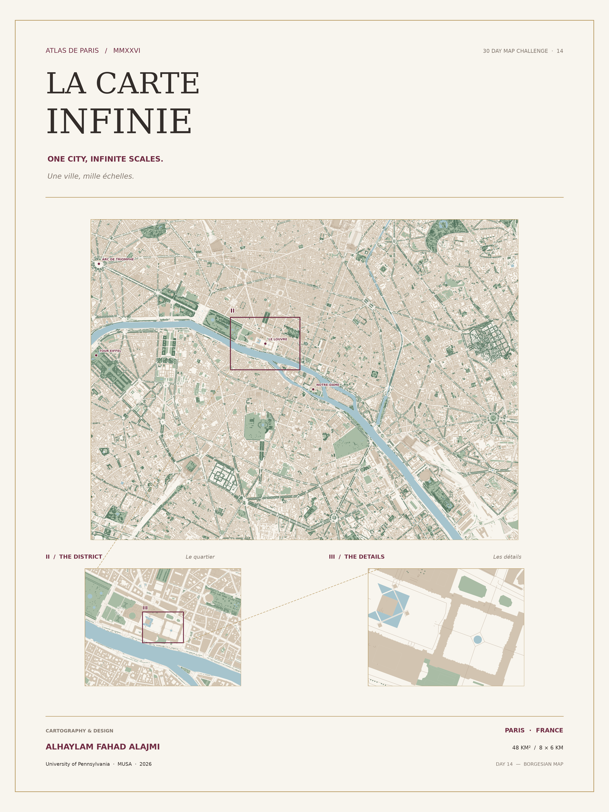

# La Carte Infinie — Paris

**30DayMapChallenge 2026 | Day 14 — Borgesian Map**

*One city, infinite scales. / Une ville, mille échelles.*

## Project Overview

La Carte Infinie explores Paris through multiple levels of geographic detail.

Inspired by the Borgesian Map theme, the project moves from a city-wide perspective to individual urban features, revealing how a city changes as the viewing scale changes.

The project includes an interactive 3D map and a 2D editorial poster.

## Interactive Map

[Explore La Carte Infinie — Paris](exports/Paris_La_Carte_Infinie_PUBLISH.html)

The interactive map includes:

- 3D building footprints
- Streets and the Seine River
- Parks and individual trees
- Selected Paris landmarks
- Zoom-dependent map details
- Interactive navigation and camera controls

**Note:** Building heights are illustrative (15 meters), not measured heights.

## Final Poster

The poster presents three connected geographic scales:

1. **The City** — Paris study area
2. **The District** — Louvre neighborhood
3. **The Details** — Individual urban features

[Download Poster PDF](exports/Day14_La_Carte_Infinie_Paris_Poster.pdf)

## Study Area

- Location: Paris, France
- Approximate area: 48 km²
- Study extent: 8 × 6 km
- Coordinate reference system for spatial analysis: EPSG:2154

## Data and Tools

- OpenStreetMap geographic features
- Python and GeoPandas
- Shapely and Matplotlib
- MapLibre GL JS
- Jupyter Notebook

## Limitations

OpenStreetMap data completeness varies across locations. The interactive building heights are illustrative, and the highlighted study boundary does not restrict navigation beyond the study area.

## Author

**Alhaylam Fahad Alajmi**

Master of Urban Spatial Analytics (MUSA)  
University of Pennsylvania

**30DayMapChallenge 2026**
